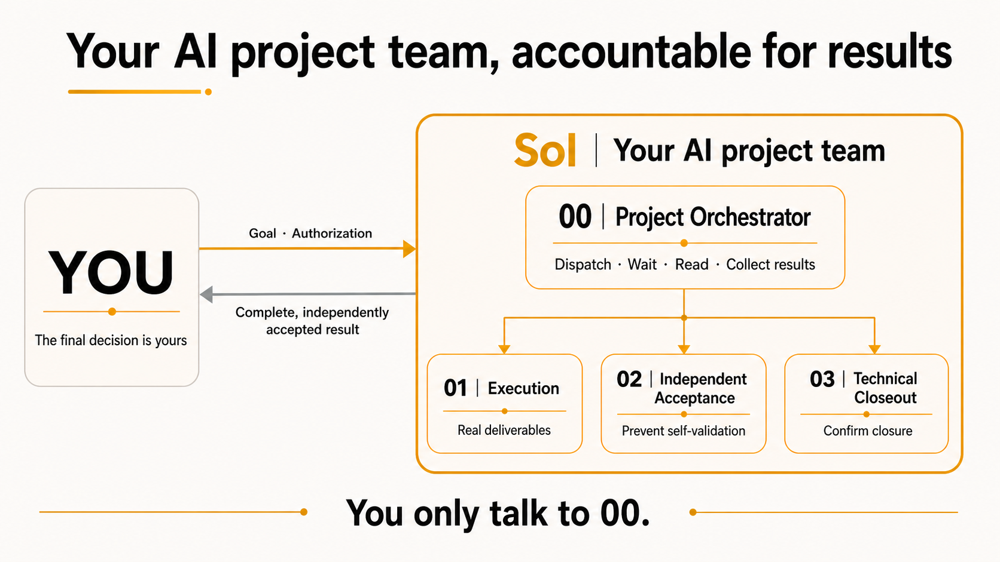
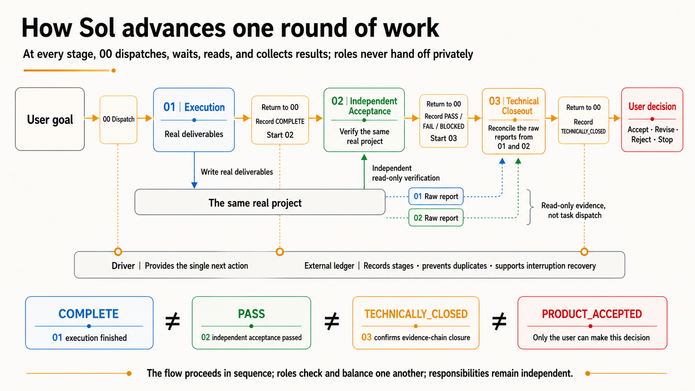

# Sol

[简体中文](README.md) | English

`Sol Project Orchestrator`

> **Give creators back their valuable attention and decision-making capacity.**
>
> **Give yourself an AI project team that is accountable for results.**

<p align="center">
  
</p>

The more AI windows you open, the busier you may become.

Every additional AI window requires you to explain the goal, progress, dependencies, and completion criteria again. If you supervise continuously, the time saved by AI is consumed by oversight. If you do not, you worry that a window may drift or declare success on its own. AI executes faster, but you become the project manager who tracks progress, reconstructs context, and performs final acceptance.

Self-review by the execution window is not the same as independent acceptance. It may keep using the same context, mistaken premise, and checking method, then prove itself correct inside its own logic. Self-review is useful, but it cannot replace independent acceptance.

**Sol was built for this problem.**

It does not give you four AI windows that you must personally manage. It gives you a project team organized around one goal, with separate responsibilities for execution, independent acceptance, technical closeout, and accountability for the complete result.

You talk only to one controller. The controller creates the other three tasks and, following the driver's single next action, dispatches each stage, waits, and reads the result. In a normal workflow, you do not need to enter the other three windows, ask for progress, or manually carry context between them. Sol returns to you only when it needs authorization, additional information, exception handling, or a final decision.

**You own the goal and the decisions. The controller owns process advancement and result collection.**

## Understand Sol in 30 seconds

<p align="center">
  
</p>

```text
You: 立项：Add a file-fingerprint tool to this project and include tests

00 | Freeze the goal, then create and bind 01 / 02 / 03

You: 去执行

01 | Produce the real deliverable and report the execution result
     ↓
02 | Independently and read-only verify the frozen goal and real artifact
     ↓
03 | Read the original reports from 01 and 02 and determine whether
     the evidence forms a technical closeout
     ↓
00 | Wait for and read each stage, then explain what is complete,
     what is verified, and what is genuinely blocked

You: 接受产品 / 需要修订 / 拒绝产品
```

The arrows mean that 00 advances stages according to the driver. They do not mean that 01, 02, and 03 privately assign work or pass messages to one another. The four windows are how Sol works; they are not four jobs for you to manage. You do not create downstream windows or copy task IDs, JSON, receipts, or internal commands.

## Four roles, one chain of responsibility

| Role | Responsibility | Boundary |
| --- | --- | --- |
| `00｜Sol Project Controller` | Freeze the goal, advance the workflow, wait for and read stage results, and return the complete facts to you | Does not replace 02's acceptance and does not accept the product for you |
| `01｜Execution` | Produce the real deliverable against the frozen goal and report the actual result | Cannot accept its own work |
| `02｜Independent Acceptance` | Independently and read-only verify the frozen goal and real artifact, then report an acceptance result | Does not modify the product |
| `03｜Technical Closeout` | Read the original reports from 01 and 02 separately and determine whether the goal, evidence, and blockers form a technical closeout | Is not a second acceptance role |
| **You (final decision-maker)** | Decide the goal, taste, tradeoffs, and whether to accept the product | Do not need to become a fifth acceptance role |

The three downstream roles work independently. All advancement and result collection go through the controller. Following the driver's single next action, 00 dispatches, waits for, and reads each role in sequence. After 01 completes real execution, the driver records the execution-stage facts. Then 02 independently checks the frozen goal and real artifact rather than treating 01's success claim as acceptance. Finally, 03 reads the original 01 and 02 reports by exact task identity and determines whether the evidence can be technically closed. Every result returns to 00, which explains the complete facts to you in plain language.

Sol keeps four commonly confused facts separate:

```text
COMPLETE ≠ PASS ≠ TECHNICALLY_CLOSED ≠ PRODUCT_ACCEPTED
```

- `COMPLETE`: 01 reports execution complete.
- `PASS`: 02 independently accepts the result.
- `TECHNICALLY_CLOSED`: 03 confirms that the technical evidence chain can be closed.
- `PRODUCT_ACCEPTED`: only your explicit decision can produce this state.

The executor cannot issue its own acceptance. The acceptance role cannot modify the product. Technical closeout cannot impersonate your decision.

## Why you can supervise less

### No progress chasing or manual result collection

Through the driver, 00 obtains the current stage and single next action from the external ledger, then waits for and reads 01, 02, and 03 in sequence. You do not need to open every window to ask where the work stands or combine three reports yourself.

### Responsibility returns to the controller

Sol does more than dispatch work. It confirms that each stage result has returned, then the controller brings the execution, acceptance, and closeout facts back to you. When something fails, Sol returns the real blocker instead of calling the work "almost successful."

### Recovery after interruption

Workflow state is stored in a single authoritative SQLite ledger outside the project and does not depend on chat memory. After an application or task interruption, Sol restores the current stage, deduplication state, and single next action from that ledger.

### Stop when uncertain

Each round advances only one Host action specified by the driver. Side-effecting actions are not resent blindly. If a receipt is unknown, evidence is insufficient, or acceptance fails, the workflow stops at the real state instead of advancing automatically to success.

### Control files stay out of your project

Sol does not write its ledger into your project, run Git commands, or directly modify `.git/**`. Your working tree should contain only product changes permitted by the frozen goal.

Sol reduces the risks of self-certification, omission, and manual tracking. It does not claim that different AI tasks can never share the same bias, and it does not describe the SQLite ledger as a tamper-proof security system.

## What you say to the controller

- `立项：<non-empty goal>`: freeze a goal and prepare the four-task chain.
- `去执行`: authorize 01 to begin real product work.
- `接受产品`: make the final product-acceptance decision.
- `需要修订`: preserve the facts, end the current chain, and mark revision as required.
- `拒绝产品`: reject the current product result.
- `继续核对` and `停止`: use only when Sol explicitly offers the corresponding option.

The Chinese trigger phrases above are the exact commands recognized by v0.3.3.

## When Sol is worth using

Sol is useful when a task has a long delivery chain, will be iterated over time, carries a meaningful cost of failure, or requires execution, acceptance, and closeout to remain separate.

A translation, one title edit, or a concept explanation that a person can verify in a few minutes usually does not need a four-role responsibility chain. Sol should not over-govern simple work.

The current version supports only a fresh A0 starting point inside one saved Codex project and always uses the four tasks 00, 01, 02, and 03. It does not automatically migrate old ledgers or combine cross-project state into one recovery.

## Installation

Extract the seven files from the formal ZIP and preserve their directory structure in either location:

- User scope: `$HOME/.agents/skills/sol-project-orchestrator`
- Repository scope: `$REPO_ROOT/.agents/skills/sol-project-orchestrator`

Restart Codex if the new Skill does not appear. See the [official Codex Skills documentation](https://developers.openai.com/codex/skills) for installation and discovery rules.

## v0.3.3 verified identity

The same exact formal ZIP completed the full product chain in both fresh Windows Git and fresh macOS Git projects. Neither result was accepted automatically by the system; each entered `PRODUCT_ACCEPTED` only after an explicit final product decision.

- Formal package: `sol-project-orchestrator-0.3.3.zip`
- Size: `31633` bytes
- SHA-256: `92a62af2641e027390c8bbfe2d64d710bc2fb5f267cf470cb75d5dc31d3c0b84`
- Release tree SHA-256: `0cb9a029e29cd57af9609d4b6be88dfe63e5dd8dfc9c424afb9e90fedd5641ae`

The complete frozen-source static suite passed `59/59`. The public snapshot excludes private internal state documents and its public-layout suite passed `57/57`; the two omitted checks cover only those internal state documents, not runtime code.

## Creator and collaboration

Sol was initiated and led by Ningning, in collaboration with Codex. Codex was used as an AI collaborator during the creation and development of this project and is not a copyright holder.

Copyright © 2026 Ningning.

## License and project relationship

This is a **source-available** project for noncommercial use. It is not open-source software under the OSI definition:

- Software, runtime files, and machine-readable operational files: PolyForm Noncommercial 1.0.0.
- Documentation and written materials: CC BY-NC 4.0.
- Commercial use requires prior written permission from the copyright holder. Licensing inquiries: [janiezhang93@gmail.com](mailto:janiezhang93@gmail.com).

See `LICENSE` and `LICENSES/` for the complete terms. Sol is an independent community project and is not affiliated with, sponsored by, approved by, or endorsed by OpenAI.
