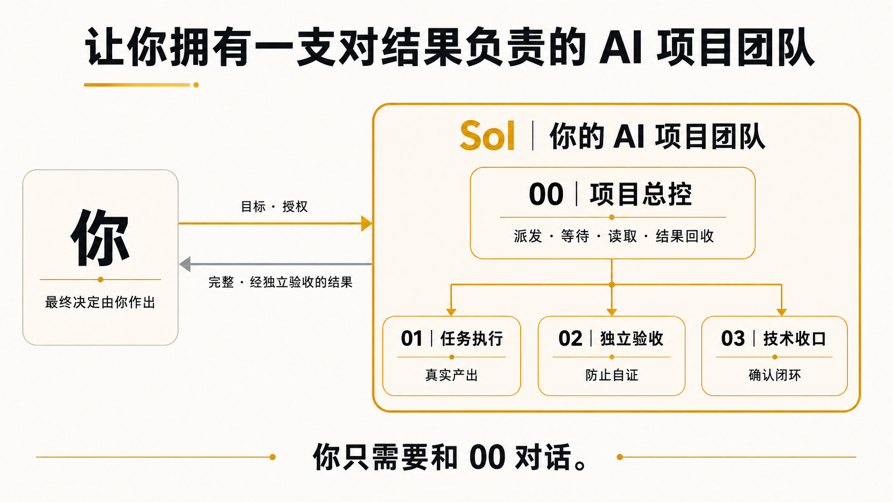
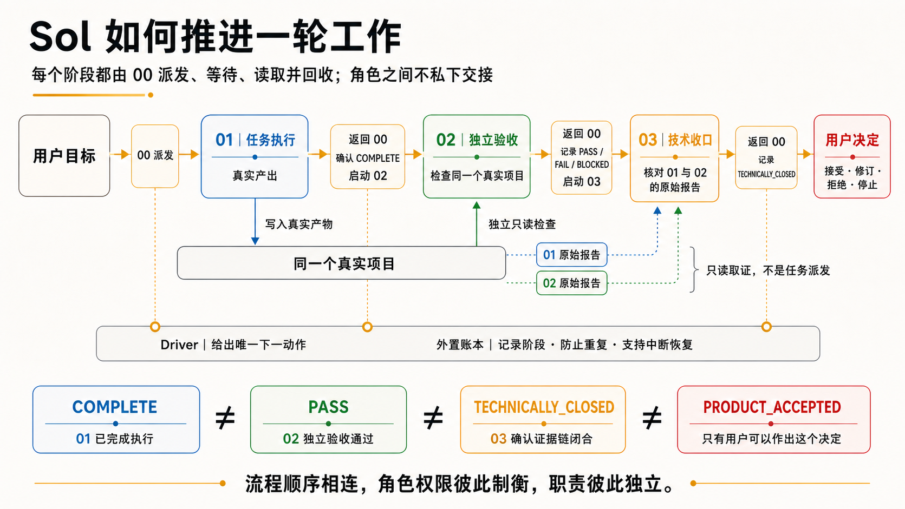

# Sol

简体中文 | [English](README.en.md)

`Sol Project Orchestrator`

> **把宝贵的注意力和决策力，还给创作者。**
>
> **让你拥有一支对结果负责的 AI 项目团队。**

<p align="center">
  
</p>

AI 窗口开得越多，人反而可能越忙。

每多开一个 AI 窗口，你都要重新解释目标、进度、依赖和完成标准。一直盯着，节省的时间被监督吃掉；不盯，又担心窗口跑偏或自行宣布成功。AI 执行得更快，你却成了追进度、拼上下文和做最终验收的项目经理。

让执行窗口自查也不等于独立验收。它仍可能沿用同一上下文、错误前提和检查方法，在自己的逻辑里证明自己。自查有用，但不能替代独立验收。

**Sol 为这个问题而生。**

它给你的不是四个需要亲自管理的 AI 窗口，而是一支围绕同一目标、职责彼此分离的项目团队：有人执行、有人独立验收、有人核对技术闭环、有人对完整结果负责。

你只需要跟一个总控窗口对话。其余三个任务由总控创建，并按 driver 给出的唯一下一动作依次派发、等待和读取。正常工作链中，你不需要进入另外三个窗口查看进度、追问结果或手工搬运上下文。只有需要你的授权、补充信息、异常处置或最终决定时，Sol 才会回到你。

**你只管目标和决定，总控负责过程推进和结果回收。**

## 30 秒看懂

<p align="center">
  
</p>

```text
你：立项：为这个项目新增一个文件指纹工具，并补测试

00｜冻结目标，创建并绑定 01 / 02 / 03

你：去执行

01｜完成真实产出并报告执行结果
    ↓
02｜独立、只读检查冻结目标与真实产物，并报告验收结论
    ↓
03｜分别读取 01 / 02 的原始报告，核对能否形成技术闭环
    ↓
00｜等待并读取各阶段结果，把已完成、已验证和真实阻断用人话告诉你

你：接受产品 / 需要修订 / 拒绝产品
```

箭头表示 00 按 driver 的指令推进阶段，不表示 01、02、03 彼此直接派活或互相传话。四个窗口是 Sol 的工作方式，不是你要管理的四份工作。你不用创建下游窗口，也不用复制任务 ID、JSON、回执或内部命令。

## 四个角色，一条责任链

| 角色 | 负责什么 | 权限边界 |
| --- | --- | --- |
| `00｜Sol 项目总控` | 冻结目标、推进流程、等待和读取阶段结果，并把完整事实送回给你 | 不替 02 验收，不替你接受产品 |
| `01｜任务执行` | 按冻结目标完成真实产出并报告实际结果 | 不能自行验收 |
| `02｜独立验收` | 独立、只读检查冻结目标与真实产物，并报告验收结论 | 不修改产品 |
| `03｜技术收口` | 分别读取 01、02 的原始报告，核对目标、证据和阻断能否形成技术闭环 | 不是第二个验收官 |
| **你（最终决定者）** | 决定目标、品味、取舍和最终是否接受产品 | 不需要充当第五个验收官 |

三个下游角色独立工作，所有推进和结果回收都经过总控。00 按 driver 给出的唯一下一动作依次派发、等待和读取三个角色：01 完成真实执行后，driver 记录执行阶段事实；随后 02 独立检查冻结目标和真实产物，不以 01 的自报成功作为验收依据；最后 03 按精确任务身份分别读取 01 和 02 的原始报告，核对能否形成技术闭环。所有阶段结果最终都回到 00，再由 00 把完整事实用人话告诉你。

Sol 把四个常被混在一起的事实分开：

```text
COMPLETE ≠ PASS ≠ TECHNICALLY_CLOSED ≠ PRODUCT_ACCEPTED
```

- `COMPLETE`：01 报告执行完成；
- `PASS`：02 独立验收通过；
- `TECHNICALLY_CLOSED`：03 确认技术证据链可以收口；
- `PRODUCT_ACCEPTED`：只有你的明确决定才能产生。

执行者不能给自己盖验收章，验收者不能修改产品，技术收口也不能冒充你的决定。

## 为什么你可以少盯一点

### 不用追进度，也不用收集结果

00 通过 driver 获取外置账本记录的当前阶段和唯一下一动作，再依次等待并读取 01、02、03 的结果。你不需要逐个打开窗口确认“做到哪了”，也不需要把三份报告重新拼成结论。

### 责任会回到总控

Sol 不只负责把任务发出去，还负责确认阶段结果已经返回，并由总控把经过执行、验收和收口的事实送回给你。失败时送回的是真实阻断，不是“差不多成功”。

### 中断后可以恢复

流程状态保存在项目外的唯一 SQLite 账本中，不依赖聊天记忆。应用或任务中断后，Sol 先从账本恢复当前阶段、去重状态和唯一下一动作。

### 不确定就停

每轮只推动 driver 指定的一条 Host 动作。副作用操作不盲目重发；如果回执未知、证据不足或验收失败，流程停在真实状态，不自动跳到成功。

### 控制文件不污染项目

Sol 的账本不写进你的项目，不执行 Git 命令，也不直接修改 `.git/**`。你的工作区只应出现冻结目标允许的产品差异。

Sol 降低的是自证、遗漏和人工追踪风险；它不声称不同 AI 任务之间绝对不存在共同偏差，也不把 SQLite 账本描述成防篡改安全系统。

## 你只需要对总控说什么

- `立项：<非空目标>`：冻结目标并准备四任务链。
- `去执行`：允许 01 开始真实产品工作。
- `接受产品`：作出最终产品接受决定。
- `需要修订`：保留事实，结束当前链并标记需要修订。
- `拒绝产品`：拒绝当前产品结果。
- `继续核对`、`停止`：仅在 Sol 明确给出相应选项时使用。

## 什么时候值得使用

Sol 适合任务链较长、会持续迭代、失败代价较高，或者需要把执行、验收和收口分开的项目。

一句翻译、改一个标题、解释一个概念等几分钟就能人工确认的工作，通常不需要四角色责任链。Sol 不应该把简单任务过度治理。

当前版本只支持同一个已保存 Codex 项目中的 fresh A0 起点，固定使用 00、01、02、03 四个任务；不自动迁移旧账本，也不把跨项目状态拼接成一次恢复。

## 安装

将正式 ZIP 解包后的 7 个文件按原目录结构放入以下任一位置：

- 用户级：`$HOME/.agents/skills/sol-project-orchestrator`
- 仓库级：`$REPO_ROOT/.agents/skills/sol-project-orchestrator`

如果新 Skill 没有出现，请重启 Codex。安装与发现规则见 [Codex Skills 官方文档](https://developers.openai.com/codex/skills)。

## v0.3.3 验证身份

同一份 exact 正式 ZIP 已分别在 fresh Windows Git 与 fresh macOS Git 项目中走完完整产品链。两次都不是由系统自动判定成功，而是在明确的最终产品决定后进入 `PRODUCT_ACCEPTED`。

- 正式包：`sol-project-orchestrator-0.3.3.zip`
- 大小：`31633` bytes
- SHA-256：`92a62af2641e027390c8bbfe2d64d710bc2fb5f267cf470cb75d5dc31d3c0b84`
- release tree SHA-256：`0cb9a029e29cd57af9609d4b6be88dfe63e5dd8dfc9c424afb9e90fedd5641ae`

冻结源完整静态套件为 `59/59 PASS`。公开快照移除了不公开的内部状态文档，公开布局套件为 `57/57 PASS`；少的两项仅检查内部状态文档，不是运行时代码测试。

## 作者与协作

Sol 由 Ningning 发起并主导，与 Codex 协作完成。Codex 是创作与开发过程中的 AI 协作者，不是版权主体。

Copyright © 2026 Ningning.

## 许可证与项目关系

这是源代码公开可见、仅限非商业使用的 **source-available** 项目，不是 OSI 定义的开源软件：

- 软件、运行文件与机器可读操作文件：PolyForm Noncommercial 1.0.0；
- 文档与文字材料：CC BY-NC 4.0；
- 商业使用：必须事先取得版权所有者的书面许可。授权咨询：[janiezhang93@gmail.com](mailto:janiezhang93@gmail.com)。

完整条款见 `LICENSE` 与 `LICENSES/`。Sol 是独立社区项目，与 OpenAI 没有隶属、赞助、官方认可或背书关系。
